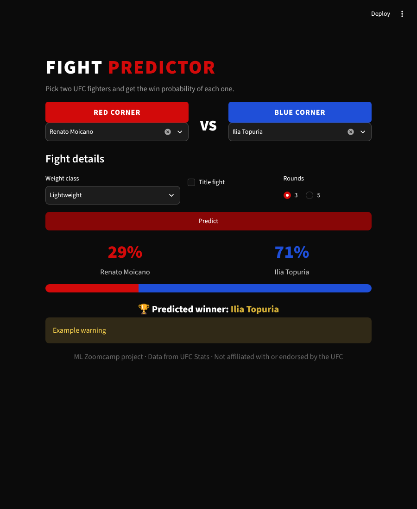
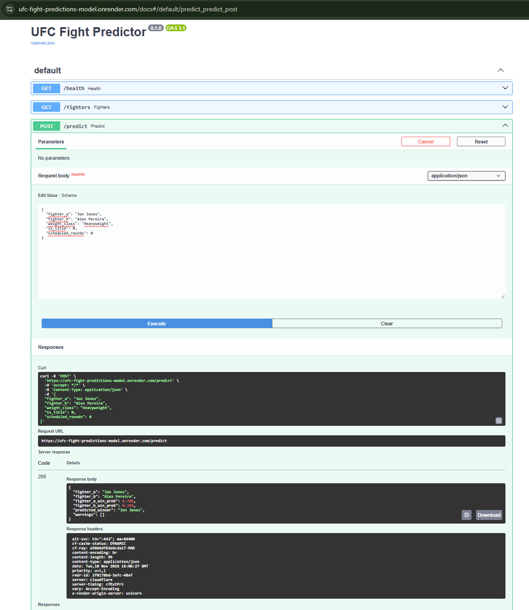

# UFC Fight Predictor

Predict the winner of a UFC fight, including fights that have not happened yet, using only each fighter's history **before** the fight.



> ML Zoomcamp 2026 – Midterm project. Not affiliated with or endorsed by the UFC.

---

## 1. Problem description

MMA fans, analysts and fantasy players constantly debate matchups: *who would win, A or B?* Opinions are usually based on highlights and reputation. This project builds a data-driven answer.

**Goal:** given two UFC fighters, estimate the probability that each one wins.

**How it is used:** the model is served as a web API. You send two fighter names (and optionally the weight class, whether it is a title fight and the number of rounds), and the service returns:

- the win probability of each fighter,
- the predicted winner,
- warnings when the prediction is less reliable (inactive fighters, very little UFC experience).

It works for **scheduled fights** and for **hypothetical matchups** between fighters who share a weight class. A simple web interface (Streamlit) is included to use it without writing any code.

**Key challenge – avoiding data leakage.** The raw data contains the statistics *of each fight* (strikes landed, takedowns, control time…). Using them to predict that same fight would be cheating. Instead, every feature is built only from the fighter's **previous** fights: career averages, accuracy, defense, win rate, experience and physical attributes as they were on the day of the fight.

---

## 2. Dataset

- **Source:** [Greco1899/scrape_ufc_stats](https://github.com/Greco1899/scrape_ufc_stats), a weekly-updated scrape of [UFC Stats](http://ufcstats.com) (GPL-3.0 license).
- **Version used:** commit `3d4886d222e72be2c5336b49b98b721f5103d949` (31 Oct 2026).
- **Files used** (stored in `data/`):

| File | Content |
|---|---|
| `ufc_event_details.csv` | Event name and date |
| `ufc_fight_results.csv` | Result, method, round, time and weight class of each fight |
| `ufc_fight_stats.csv` | Round-by-round statistics of each fighter |
| `ufc_fighter_tott.csv` | Height, reach, stance and date of birth |

The deployed model includes fights up to **31 Oct 2026** (date of the latest event in this data version). The API reports this date in `GET /health` (`data_until`), and the web interface displays it.

The data is already committed in the repository. To download it again:

```bash
bash download_data.sh
```

---

## 3. Approach

### Data preparation (`features.py`)
- Parsed text fields such as `"13 of 18"`, `"4:07"` and `5' 11"` into numbers.
- Kept only fights with the modern 3- or 5-round format (dropped ~3% of early-era fights with non-standard rules).
- Normalised 71 weight-class labels into 10 divisions, and extracted `is_title` and `is_women`.
- Aggregated round statistics per fighter and fight, and joined each fighter with his opponent's statistics (to measure defense).
- Removed fighters with ambiguous (duplicated) names, and duplicated events listed under two names.

### Pre-fight features (no leakage)
For every fighter and fight, cumulative sums of **previous** fights only (`cumsum − current fight`), turned into ratios:

| Feature | Meaning |
|---|---|
| `prev_fights`, `win_rate` | Experience and record |
| `slpm`, `sapm` | Significant strikes landed / absorbed per minute |
| `str_acc`, `str_def` | Striking accuracy and defense |
| `td_avg`, `td_acc`, `td_def` | Takedowns per 15 min, accuracy and defense |
| `sub_avg`, `kd_avg` | Submission attempts and knockdowns per 15 min |
| `ctrl_pct` | Share of fight time spent in control |
| `height_cm`, `reach_cm`, `age` | Physical attributes (age on fight day) |

Per-minute rates are set to missing when a fighter has less than 5 minutes of previous UFC fight time, to avoid absurd values (e.g. a 7-second knockout would mean 128 knockdowns per 15 minutes).

### Symmetric dataset
Each fight is included **twice**, once from each fighter's perspective, with features expressed as differences (A − B) and the target `win`. This removes the ordering bias of the source data (the first-listed fighter wins ~63% of the time) and makes the target perfectly balanced. At prediction time, the service predicts both orders and averages them, so the result does not depend on the order of the names.

---

## 4. Exploratory data analysis

Full analysis in [`notebook.ipynb`](notebook.ipynb). Main findings:

- **Age is the strongest single factor:** the younger fighter wins about 61% of the time in the most extreme age gaps.
- **Strikes absorbed per minute, win rate and striking defense** are the next most informative features.
- Reach helps, but less than expected; stance has a small effect (southpaws beat orthodox fighters 54% of the time).
- Most missing values are structural (debutants have no history; takedown accuracy is undefined for fighters who never attempted one).
- No single feature exceeds a ROC AUC of 0.58: each one is only a weak signal on its own.

---

## 5. Model training and selection

Time-based split, to simulate predicting the future from the past:

| Set | Period | Rows |
|---|---|---|
| Train | 1999 – 2022 | ~13,100 |
| Validation | 2023 – 2024 | ~2,000 |
| Test | 2025 – 2026 | ~1,900 |

Models trained and tuned on the validation set:

| Model | Tuned parameters | Val AUC | Val log loss |
|---|---|---|---|
| Baseline (best single feature: `age_diff`) | – | 0.584 | – |
| Logistic regression | `C` | 0.646 | 0.657 |
| Random forest | `max_depth`, `min_samples_leaf`, `n_estimators` | 0.650 | 0.660 |
| **XGBoost** | `eta`, `max_depth`, `min_child_weight` (+ early stopping) | **0.650** | **0.656** |

**XGBoost** was selected: it ties for the best AUC, has the best log loss (the most relevant metric, since the service returns probabilities) and handles missing values natively.

### Final evaluation (test set, fights from 2025–2026)

| Metric | Value |
|---|---|
| ROC AUC | **0.640** |
| Log loss | **0.668** |

The small drop from validation to test is expected when predicting a later period. MMA is hard to predict from statistics alone, so the output should be read as a data-driven estimate, not a certainty.

The deployed model is retrained on **all** available data with the same parameters, so that it also learns from the most recent fights.

---

## 6. Project structure

```
├── data/                  # Raw CSV files (UFC Stats scrape)
├── images/                # Screenshots for this README
├── .streamlit/config.toml # Web interface theme
├── download_data.sh       # Downloads the dataset (pinned commit)
├── notebook.ipynb         # Data cleaning, EDA, model selection and tuning
├── features.py            # Data cleaning and feature engineering pipeline
├── train.py               # Trains the final model and saves model.bin
├── predict.py             # FastAPI web service
├── app.py                 # Streamlit web interface
├── model.bin              # Trained model (DictVectorizer + XGBoost + fighter snapshot)
├── Dockerfile
├── pyproject.toml / uv.lock
└── README.md
```

---

## 7. How to run

### 7.1 Environment

The project uses [uv](https://docs.astral.sh/uv/) for dependency and virtual environment management.

```bash
# Install uv (if needed)
curl -LsSf https://astral.sh/uv/install.sh | sh

# Clone the repository
git clone https://github.com/sotomarcos24/UFC-FIGHT-PREDICTIONS.git
cd UFC-FIGHT-PREDICTIONS

# Create the virtual environment and install all dependencies
uv sync

# Activate the environment (optional: you can also prefix commands with `uv run`)
source .venv/bin/activate
```

### 7.2 Notebook

```bash
uv run jupyter lab notebook.ipynb
```

### 7.3 Train the model

```bash
uv run python train.py
```

This builds the dataset from `data/`, trains the final XGBoost model and saves `model.bin`.

### 7.4 Run the prediction service

```bash
uv run uvicorn predict:app --host 0.0.0.0 --port 9696
```

Interactive documentation: http://localhost:9696/docs

### 7.5 Run the web interface

In a second terminal, with the service running:

```bash
uv run streamlit run app.py
```

Open http://localhost:8501. To point it to another API, set `API_URL`:

```bash
API_URL=https://<your-api-url> uv run streamlit run app.py
```

---

## 8. Docker

Build the image:

```bash
docker build -t ufc-fight-predictor .
```

Run the container:

```bash
docker run -it --rm -p 9696:9696 ufc-fight-predictor
```

The service is then available at http://localhost:9696/docs.

---

## 9. API usage

### Endpoints

| Method | Endpoint | Description |
|---|---|---|
| `GET` | `/health` | Health check and data cutoff date |
| `GET` | `/fighters` | List of fighters with their current and eligible weight classes |
| `POST` | `/predict` | Win probabilities for a fight |

### Example request

```bash
curl -X POST http://localhost:9696/predict \
     -H "Content-Type: application/json" \
     -d '{"fighter_a": "Renato Moicano", "fighter_b": "Ilia Topuria"}'
```

Optional fields: `weight_class`, `is_title` (0/1) and `scheduled_rounds` (3/5).

### Example response

```json
{
  "fighter_a": "Renato Moicano",
  "fighter_b": "Ilia Topuria",
  "fighter_a_win_prob": 0.286,
  "fighter_b_win_prob": 0.714,
  "predicted_winner": "Ilia Topuria",
  "warnings": []
}
```

Errors:
- `404`: a fighter name was not found (names must match UFC Stats, e.g. `Paddy Pimblett`).
- `400`: invalid matchup (same fighter twice, or fighters with no weight class in common).

---

## 10. Cloud deployment

<!-- TODO: fill in after deploying -->

- **Web interface:** https://ufc-fight-predictions.onrender.com
- **API:** https://ufc-fight-predictions-model.onrender.com/docs

Both are deployed on [Render](https://render.com) from this repository's `Dockerfile`. The interface uses the same image with a different start command and the `API_URL` environment variable pointing to the API.

> On Render's free plan the services go to sleep after inactivity: the first request can take 30–60 seconds.



---

## 11. Limitations and future work

- **Weight classes.** The model was trained only on same-division fights, so it cannot judge size differences. Each fighter is assigned the divisions where he has at least 20% of his UFC fights, plus the division of his latest fight. Fighters can only be matched if they share a division.
- **UFC-only history.** Fights outside the UFC are not included, so debutants have no statistics.
- **Recent form.** Features are career averages; recent performance (last 3–5 fights) could add signal.
- **Fighter names** must match UFC Stats exactly in the API (the web interface offers suggestions).
- **Possible improvements:** recent-form and streak features, Bayesian smoothing of rates for fighters with little cage time, comparison with betting odds, and automatic data refresh.